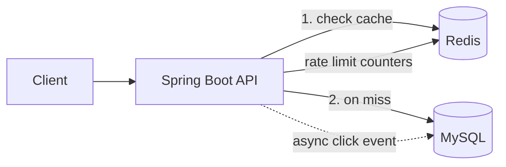
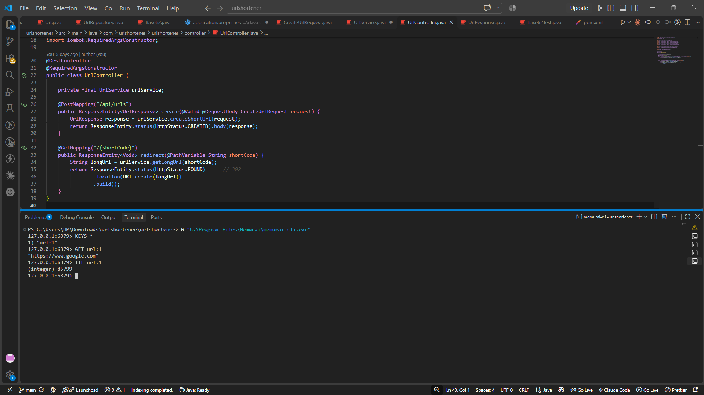
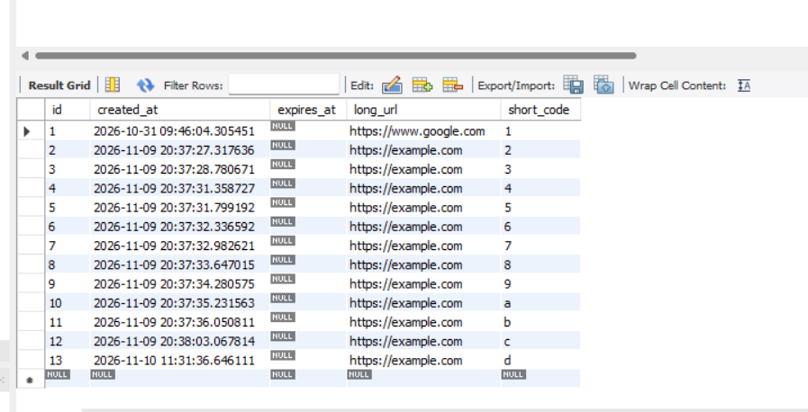
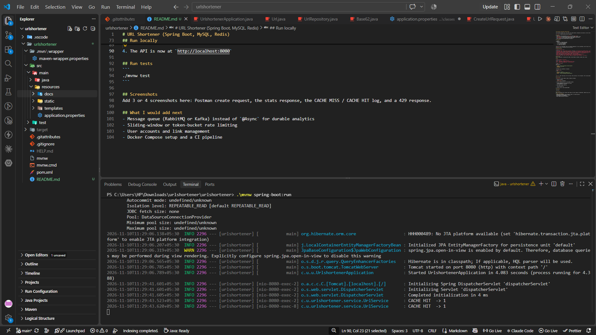
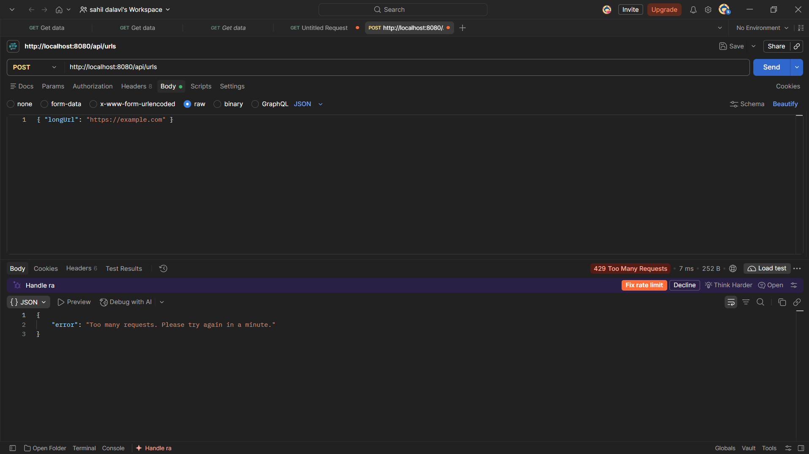

# URL Shortener (Spring Boot, MySQL, Redis)

A URL shortener designed like a real system: fast cached redirects, background click analytics, and rate limiting.

**Live demo:** https://url-shortener-k4rf.onrender.com 

## Features
- Create short links with optional **custom alias** and **expiry date**
- **302 redirect** with Redis cache-aside (falls back to MySQL if Redis is down)
- **Click analytics** (total clicks, browser, device) recorded asynchronously
- **Rate limiting** per IP using Redis counters (HTTP 429)
- Input validation and consistent JSON error responses

## Architecture



**Redirect flow:** check Redis, and on a hit redirect immediately. On a miss read MySQL, store the result in Redis with a TTL, then redirect. The click is saved on a background thread so tracking never slows the redirect.

## Design decisions

| Problem | Decision | Why |
|---|---|---|
| Unique short codes | Auto-increment ID encoded in **Base62** | No collisions and no uniqueness checks. 7 characters give about 3.5 trillion codes |
| Slow database reads | **Redis cache-aside** with TTL | Redirects are read-heavy; memory is faster than disk |
| Expired links served from cache | Cache TTL never exceeds the link's expiry | An expired link can't be served from cache |
| Analytics slowing redirects | `@Async` click recording | The user doesn't wait for the database write |
| Redis outage | try/catch fallback to MySQL | Slower, but never broken |
| Abuse | Fixed-window rate limit using Redis `INCR` | Atomic and shared across instances |
| 301 vs 302 | **302** | 301 is cached by browsers, so clicks would go uncounted |
| Money-safe URLs | Only `http` and `https` schemes are accepted | Blocks `javascript:` and similar |

## Tech stack
Java 21, Spring Boot 4, Spring Data JPA, MySQL 8, Redis (Memurai on Windows), Lombok, JUnit 5, Maven

## API

| Method | Endpoint | Description |
|---|---|---|
| POST | `/api/urls` | Create a short URL |
| GET | `/{shortCode}` | Redirect to the original URL (302) |
| GET | `/api/urls/{shortCode}/stats` | Click statistics |

**Create a short URL**
```json
POST /api/urls
{
  "longUrl": "https://www.example.com/some/long/path",
  "customAlias": "my-link",
  "expiryDays": 7
}
```
`customAlias` and `expiryDays` are optional.

**Response (201)**
```json
{
  "shortCode": "my-link",
  "shortUrl": "http://localhost:8080/my-link",
  "longUrl": "https://www.example.com/some/long/path"
}
```

**Errors:** `400` invalid input, `404` not found, `409` alias taken, `410` link expired, `429` too many requests

## Run locally

**Requirements:** JDK 21, MySQL 8, Redis (or Memurai on Windows)

1. Create the database:
   ```sql
   CREATE DATABASE urlshortener;
   ```
2. Set your database password as an environment variable:
   ```
   # Windows (PowerShell), then reopen the terminal
   setx DB_PASSWORD "NewPass@123"
   ```
3. Start MySQL and Redis, then run:
   ```
   ./mvnw spring-boot:run
   ```
4. The API is now at `http://localhost:8080`

## Run tests
```
./mvnw test
```

## Screenshots





## What I would add next
- Message queue (RabbitMQ or Kafka) instead of `@Async` for durable analytics
- Sliding-window or token-bucket rate limiting
- User accounts and link management
- Docker Compose setup and a CI pipeline
